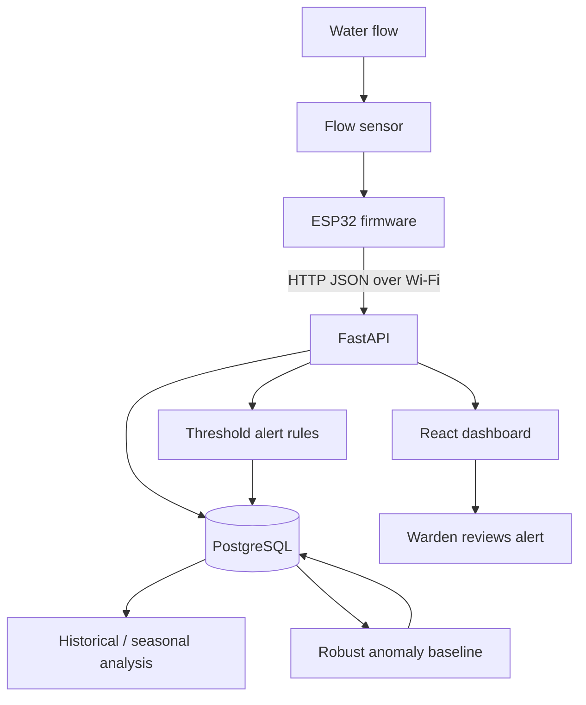

# Architecture and data flow

## Services
- Frontend: React/Vite, served by Nginx in the container build.
- Backend: FastAPI, SQLAlchemy, Pydantic.
- Database: PostgreSQL in Compose; SQLite can be used for simple local backend development.
- Firmware: ESP32 pulse counter, flow conversion and HTTP posting.
- ML: median/MAD baseline and seasonal aggregation.

## Key data rules
- Store interval volume; do not sum repeated cumulative snapshots.
- Use stable room/sensor IDs and a unique device sequence where available.
- Store server timestamps as UTC-naive values in this prototype; the API normalizes timezone-aware timestamps to UTC.
- Confirm the month-to-season mapping with the institution.
- Alert means investigate, not confirmed leak.
